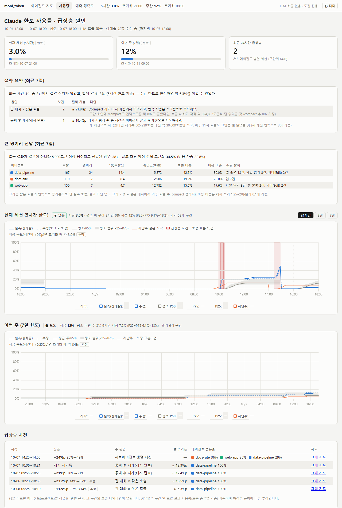
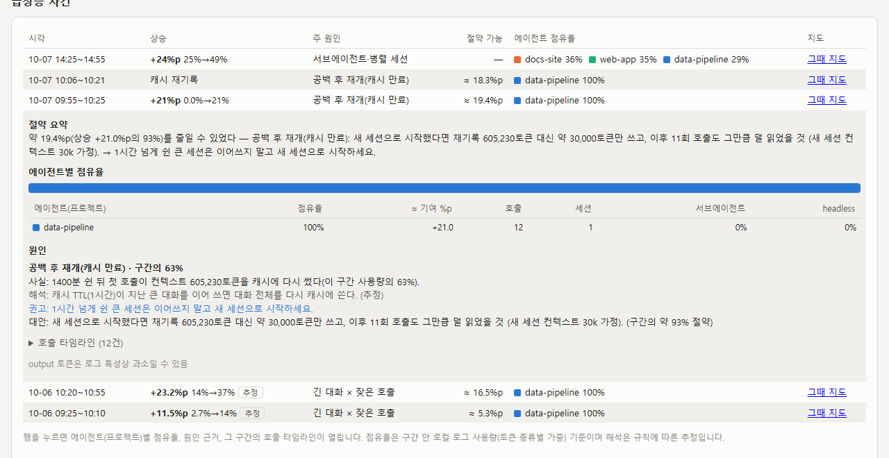
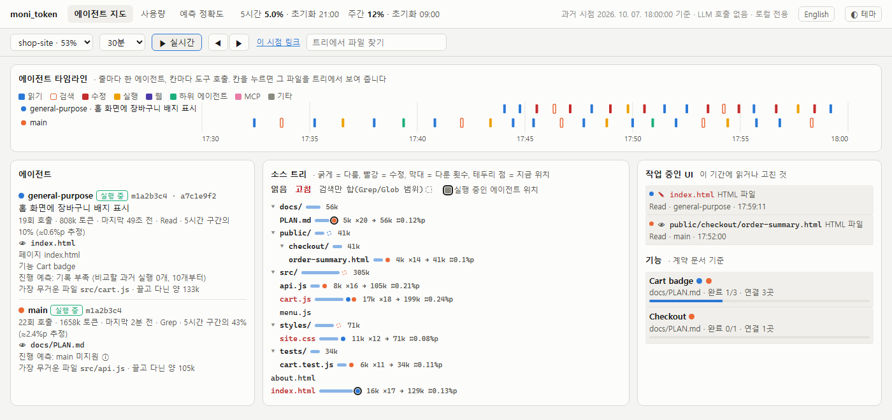
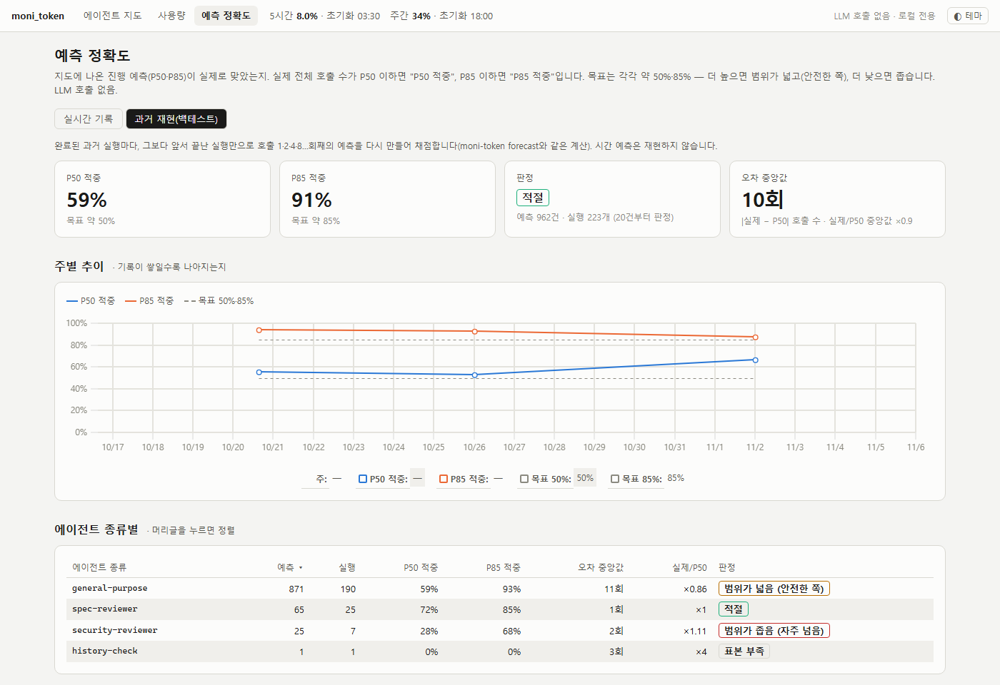

# moni_token

[English](README.md) · **한국어**

**moni_token은 LLM을 한 번도 부르지 않는, 그래서 토큰을 전혀 쓰지 않는 Claude Code 사용량 모니터입니다.** 내 PC에
있는 Claude Code 로그만 읽습니다. 5시간·주간 한도 %를 평소 범위와 나란히 보여 주고, 사용량이 튈 때마다 어느 세션이
어떤 패턴으로 그랬는지, 얼마나 아낄 수 있었는지를 규칙으로 찾아 설명합니다. 실시간 에이전트 지도에서는 메인 세션과
서브에이전트가 소스 트리의 어디서 일하는지 보이고, 실행 중인 서브에이전트에는 진행률 예측이 붙습니다. 그 예측이 얼마나
맞았는지도 스스로 채점합니다. PC 밖으로 나가는 것은 없습니다.

## 빠른 시작

Python 3.12 이상과 [uv](https://docs.astral.sh/uv/)가 필요합니다(자세한 내용은 [설치](#설치)).

```powershell
git clone https://github.com/reddol18/moni_token.git; cd moni_token; uv sync
uv run moni-token collect     # 기존 Claude Code 로그를 ~/.moni_token/usage.db로 읽어 들임
uv run moni-token map         # http://127.0.0.1:4990/ 에서 사용량 화면, 에이전트 지도, 예측 정확도
```

화면은 영어와 한국어를 지원합니다. 페이지 주소의 `?lang=ko|en`, CLI의 `--lang`, `~/.moni_token/config.toml`의
`lang = "ko"` 중 하나로 고르고, 아무것도 없으면 OS 로캘을 따릅니다. 페이지 머리줄의 전환 버튼으로도 바꿀 수 있습니다
([언어 추가하기](#언어-추가하기) 참고).

---

> "별로 한 것도 없는데 왜 50분 만에 Claude 한도가 5%나 빠졌지?"

moni_token은 Claude Code의 로컬 로그를 읽어서 이 질문에 답합니다. 한도 사용률이 갑자기 오르면 **어느 세션** 때문인지,
**어떤 패턴**이었는지(긴 대화에서 도구를 계속 호출, 오래 쉰 큰 세션을 이어 쓰기, 여러 세션을 동시에 돌리기 등),
다르게 했다면 **얼마나 아낄 수 있었는지** 알려 줍니다.

하는 일은 세 가지입니다.

1. **급상승 설명** — 한도 %의 시간 추이와 급상승 사건, 원인, 절약 가능량을 담은 정적 대시보드(2분마다 갱신,
   데스크톱 알림).
2. **진행 중 경고** — Claude Code 상태줄 앞에 `⚠ +4.0%p · 원인` 경고를 붙입니다.
   [claude-hud](https://github.com/jarrodwatts/claude-hud)를 쓰면 그 줄 앞에 붙습니다.
3. **에이전트 위치 표시** — 메인 세션과 서브에이전트가 프로젝트의 실제 소스 트리, UI 페이지, 계약 문서의 기능 중
   어디서 일하는지 보여 주는 실시간 지도.

원칙:

- **LLM을 부르지 않습니다.** 토큰을 아끼려는 도구가 토큰을 쓰면 안 되니까요. 판정은 모두 정해진 규칙으로 하고,
  설명 문장은 템플릿으로 만듭니다.
- **PC 밖으로 아무것도 보내지 않습니다.** 네트워크를 쓰지 않습니다. 대시보드는 HTML 파일이고, 에이전트 지도는
  127.0.0.1에서만 열립니다.
- **대화 내용을 저장하지 않습니다.** 숫자(토큰·시각·호출 수)와 메타데이터(세션 id, 프로젝트 폴더 이름, 모델,
  도구 이름, 크기, 도구가 다룬 프로젝트 기준 상대 경로 — [ADR-0004](docs/adr/0004-agent-map-paths-and-server.md))만 남깁니다.
- **로그는 읽기만 합니다.** Claude Code의 파일을 고치거나 지우지 않습니다.



<sub>합성 데모 데이터(`scripts/demo_report.py --lang ko`)로 찍은 화면입니다.
어두운 테마: [docs/img/ko/dashboard-dark.png](docs/img/ko/dashboard-dark.png) — OS 설정을 따르고, ◐ 버튼으로 바꿀 수 있습니다.</sub>

차트는 저장소에 함께 들어 있는 [uPlot](https://github.com/leeoniya/uPlot)으로 그립니다. 끌어서 확대하고 더블클릭으로
되돌리며, 5시간·주간 차트의 커서가 함께 움직이고, 빨간 급상승 띠를 누르면 그 사건이 열립니다.

## 화면에서 볼 수 있는 것

| 영역 | 알 수 있는 것 |
|---|---|
| 맨 위 카드 | 현재 5시간·주간 한도 사용률(%), 초기화 시각, 최근 24시간 급상승 건수 |
| 절약 요약 | 이번 주에 원인별로 몇 %p를 아낄 수 있었는지, 대안(예: "새 세션으로 시작")과 함께 |
| 큰 덩어리 전달 | 결론 대신 원문(파일 전체, 긴 명령 출력)을 그대로 넘긴 횟수와, 그걸 컨텍스트에 끌고 다닌 비용(프로젝트별) |
| 한도 그래프 | 시간에 따른 한도 %. 실선은 실측(Claude Code 상태줄 값), 점선은 로그로 추정한 값. 빨간 띠는 급상승 사건 |
| 급상승 사건 | 사건마다 원인. 행을 누르면 프로젝트별 점유율, 근거 수치, 그 구간의 호출 타임라인이 열림 |



### 알아내는 원인

| 원인 | 판정 근거 | 권고 예 |
|---|---|---|
| 긴 대화 × 잦은 호출 | 호출마다 큰 컨텍스트를 캐시에서 다시 읽고, 구간 안 호출 수가 많음 | `/compact` 하거나 새 세션에서 이어가기, 반복 작업은 스크립트로 묶기 |
| 공백 후 재개(캐시 만료) | 캐시 유효시간보다 오래 쉰 뒤 첫 호출이 대화 전체를 캐시에 다시 씀 | 오래 쉰 큰 세션은 이어 쓰지 말고 새 세션으로 시작 |
| 서브에이전트·병렬 세션 | 같은 구간에 여러 세션·사이드체인이 동시에 활동 | 동시에 돌리는 수를 줄이거나 순서대로 실행 |
| 캐시 미스 | 세션 도중 캐시 쓰기가 급증 | 작업 중 모델·설정 전환 줄이기 |
| 큰 입력 | 이미지·큰 파일을 읽은 직후 컨텍스트 급증 | 필요한 부분만 읽고, 원문은 파일로 넘기기 |
| 웹 조사 다수 | WebSearch·WebFetch 호출 집중 | 조사 범위를 좁히고 요약만 남기기 |
| 출력 폭주 | output 토큰 비중이 비정상적으로 큼 | 긴 결과물은 파일로 쓰게 하고 출력 길이 제한 |

원인과 근거 수치는 로그에서 확인한 사실이고, 해석에는 "추정"이라고 표시합니다.

## 기존 도구와의 차이

**사용량·비용 도구**

| 도구 | 잘하는 것 | moni_token이 더하는 것 |
|---|---|---|
| [ccusage](https://github.com/ryoppippi/ccusage) | 일·세션·5시간 구간별 토큰과 비용 집계 | 어떤 구간이 *왜* 비쌌는지 설명하고 사건으로 기록 |
| [Claude Code Usage Monitor](https://github.com/Maciek-roboblog/Claude-Code-Usage-Monitor) | 터미널 실시간 대시보드, 소모 속도, 한도 도달 예측 | 급상승을 세션과 패턴에 연결하고, 다르게 했을 때의 절약량 계산 |
| ccflare | 토큰·비용·속도 그래프를 보여 주는 로컬 웹 UI | 원인이 붙은 사건 목록과 호출 단위 타임라인 |
| [claude-hud](https://github.com/jarrodwatts/claude-hud) | 상태줄: 컨텍스트, 한도, 실행 중인 도구·에이전트, 할 일 | claude-hud 줄 앞에 원인이 붙은 급상승 경고(다시 만들지 않고 감싸서 씀) |
| [agents-observe](https://github.com/simple10/agents-observe) | 훅 이벤트를 로컬 웹 UI로: 서브에이전트 계층, 타임라인, 에이전트별 토큰 | 소스 트리·UI 페이지·계약 문서 기능 위의 위치 표시, 로그로 과거 세션도 읽음, Docker 불필요, 프롬프트·파일 내용 미저장 |

**진행률·남은 시간 도구** (각 도구가 직접 밝힌 내용 기준, 2026-11-13 확인. "밝히지 않음"은 페이지에 적혀 있지 않다는
뜻이지 "없다"는 뜻이 아닙니다)

| 도구 | 보여 주는 것 | 진행률·시간 추정 방식 | 모델 호출 | 자기 정확도 측정 | 5시간·주간 한도 | 실행 형태 |
|---|---|---|---|---|---|---|
| Claude Code 내장 서브에이전트 진행 요약 | 실행 중인 서브에이전트 줄에 붙는 짧은 상태 문구 | 모델이 서브에이전트 작업을 보고 씀 | 있음. 변경 기록에 "요청"으로 적혀 있고, 비용은 문서가 아니라 사용자 보고로만 나옴 | 없음 | 없음 | 내장. `CLAUDE_CODE_DISABLE_AGENT_PROGRESS_SUMMARIES=1`로 끔 |
| [claude-time-left](https://github.com/DJsluxx/claude-time-left) | 서브에이전트·긴 도구 호출·현재 턴의 경과·남은 시간·막대 | 같은 종류(`agent:Explore`, `tool:Bash`) 최근 20회의 중앙값. 기록이 없으면 기본값에 `(guess)` 표시 | 밝히지 않음 | 없음("over by …"만 표시) | 언급 없음 | 플러그인 창(대화 옆) |
| [claude-time-estimate](https://github.com/TomerBenShimol/claude-time-estimate) | 프롬프트 위 카운트다운, 백그라운드 에이전트 `sub-agents 2/5` | 할 일 목록이 있으면 완료 작업당 평균 시간 × 남은 작업 수. 없으면 지금보다 오래 걸린 과거 응답들의 중앙값(5건 이상 필요) | 없다고 설명, 네트워크 호출 없음 | 없음("대략적인 안내") | 언급 없음 | 모드(프롬프트 위 띠) |
| [claude-code-progress-board](https://github.com/ewxgwy1987/claude-code-progress-board) | 목표·작업·서브에이전트·워크플로·도구 활동별 막대와 남은 시간 | 같은 종류 최근 30회 소요 시간의 중앙값. % = 경과 ÷ 추정치, 끝나기 전엔 상한 | 타이머는 없음. 제목 없는 워크플로 에이전트 이름 짓기에만 Haiku 한 번(출력 120토큰 이하) | 없음("over estimate" 표시) | 언급 없음(별도 도구 안내) | 모드 창(터미널·데스크톱) |
| [progress-hud](https://github.com/jandro-es/progress-hud) | 서브에이전트·작업·셸·합계: ETA, 비용, 소모 속도, 컨텍스트, 사용 한도 구간 | 세션을 넘겨 쌓은 소요 시간, 시간 기반 막대, 작업 완료/전체 | 밝히지 않음(비용은 토큰 수로 계산) | 밝히지 않음 | 사용 한도 구간 표시 | 모드 창 + 한 줄 상태줄 |
| [task-progress-bar](https://github.com/PRAFULREDDYM/task-progress-bar) | 작업 완료율, 완료·진행·대기 수, 남은 시간 | 작업 파일 집계. 완료 간격의 지수이동평균(α 0.3) × 남은 작업 수 | 없음("토큰 소비 없음") | 없음 | 없음 | 상태줄 + `PostToolUse` 훅, CLI |
| [claude-code-agent-status](https://github.com/hg913488/claude-code-agent-status) | 메인 + 서브에이전트 최대 12개의 현재 동작·진행률·모델·경과 | 할 일 목록이 있으면 완료/전체, 없으면 단계 기반 추정(최대 90%) | 밝히지 않음("프롬프트에 아무것도 더하지 않음") | 밝히지 않음 | 언급 없음 | 모드 패널(`/agent-status`) |
| [savvy-progress](https://claude-mods.com/savvy-progress/) | 모든 서브에이전트의 작업·모델·effort·컨텍스트·비용·경과 | 개수만 셈: 계획된 작업(savvy-flow 사용 시)과 작업자가 보고한 단계. 예측은 없음 | 모델 호출 없음. 프롬프트에 짧은 도구 설명이 붙음 | 없음 | 없음 | 모드 패널 + 프롬프트 위 막대 |
| **moni_token** | 한도 %와 평소선, 급상승 원인, 에이전트 지도, 파일별 토큰 비용 | 같은 `agentType`으로 지금만큼 진행했던 완료 실행 10건 이상과 비교해 호출 수·시간·남은 5시간 %p의 P50/P85 | 없음 | 있음: `/accuracy` 페이지, `moni-token forecast` 재현 | 둘 다, 평소선과 함께 | 로컬 웹 페이지 + 상태줄 경고 |

- **내장 진행 요약.** 공식 [변경 기록](https://raw.githubusercontent.com/anthropics/claude-code/main/CHANGELOG.md)(2.1.323)에는
  `CLAUDE_CODE_DISABLE_AGENT_PROGRESS_SUMMARIES=1`이 "서브에이전트 진행 요약과 그것을 쓰는 요청"을 끈다고 적혀 있습니다.
  이 변수는 2.1.318부터 있었지만, 2026-11-13 기준 [환경 변수 문서](https://code.claude.com/docs/en/env-vars)에는 아직
  없습니다. 비용은 공식 수치가 아니라 사용자 보고입니다.
  [한 측정](https://bestagent.dev/claude-code-background-agent-labels-cost-2026)에서는 Haiku가 문구를 쓸 때 세션 비용의
  0.1~0.2%였고, 텔레메트리를 끄자 에이전트 컨텍스트 전체가 메인 모델로 가서 약 19%까지 올랐습니다. 15~20%라는 보고도
  있습니다. moni_token은 이 문구를 대신하지 않습니다. 켜 두든 끄든 실제로 쓴 양을 기록할 뿐입니다.
- **다른 도구가 나은 점.** 위 도구 대부분은 Claude Code 안의 창·띠·상태줄로 돌아가서 터미널을 떠나지 않고 진행 상황을
  볼 수 있습니다. moni_token의 지도와 예측은 로컬 웹 페이지에 있고, 상태줄에는 급상승 경고만 나옵니다.
  claude-time-estimate, task-progress-bar, claude-code-agent-status는 Claude의 할 일 목록(`TaskCreate` / `TodoWrite`)으로
  진행률을 셉니다. moni_token은 이 목록을 쓰지 않고, 계약 문서의 체크리스트만 봅니다. progress-hud는 셸 명령과
  에이전트별 비용까지 보여 주고, claude-time-left와 progress-board는 도구 호출과 메인 턴의 시간도 잽니다.
- **moni_token이 다른 점.** 예측은 서브에이전트만 합니다(메인 에이전트는 예측 없음). 단위도 분만이 아니라 호출 수·분·5시간
  %p이고, 지금까지 얼마나 진행했는지를 조건으로 겁니다. 자기 예측을 채점해 보여 주는(`/accuracy`) 도구는 이 표에서
  moni_token뿐입니다. 위 진행률 도구 중 예측을 5시간·주간 한도와 잇는 도구는 없습니다. progress-hud가 한도 구간을 보여
  주지만 그 한도에 대한 예측은 하지 않습니다.
- **기록이 쌓이기 전.** moni_token은 비교할 과거 실행이 10건은 있어야 예측을 보여 줍니다. claude-time-estimate는 에이전트
  1건, 턴 5건이면 되고, claude-time-left와 progress-board는 기본값으로 시작하거나 "no estimate yet"을 띄웁니다.
- **토큰 사용.** moni_token, task-progress-bar, claude-time-estimate는 모델을 부르지 않는다고 설명합니다. progress-board는
  한 경우에만 Haiku를 짧게 한 번 부르고, savvy-progress는 프롬프트에 짧은 도구 설명이 붙습니다. claude-time-left,
  progress-hud, claude-code-agent-status는 이 점을 밝히지 않습니다.
- **라이선스.** claude-time-estimate만 페이지에 라이선스가 없고, 나머지는 모두 MIT입니다.

moni_token은 이 도구들을 대체하려는 게 아닙니다. 합계는 ccusage, 실시간 HUD는 claude-hud로 보고, 숫자가 이상하거나
에이전트가 어디서 일하는지 보고 싶을 때 moni_token을 쓰면 됩니다.

<details>
<summary>출처 (2026-11-13 확인)</summary>

공식(Anthropic):
- [Claude Code 변경 기록](https://raw.githubusercontent.com/anthropics/claude-code/main/CHANGELOG.md): 진행 요약에 관한
  2.1.318, 2.1.321, 2.1.323 항목
- [환경 변수 문서](https://code.claude.com/docs/en/env-vars): `CLAUDE_CODE_DISABLE_AGENT_PROGRESS_SUMMARIES` 항목 없음
- [서브에이전트 문서](https://code.claude.com/docs/en/sub-agents): 진행 요약에 관한 절 없음

커뮤니티 보고(공식 아님):
- [bestagent.dev](https://bestagent.dev/claude-code-background-agent-labels-cost-2026): PC 한 대에서 잰 값. Haiku 문구
  0.1~0.2%, 텔레메트리를 끄면 약 19%
- [wmedia.es](https://wmedia.es/en/tips/claude-code-background-agents-status-cost): 세션 하나를 `--debug-file`로 잰 값
  (예전 방식에서 출력 14토큰에 입력 약 50k토큰)
- [flamerix-ai gist](https://gist.github.com/flamerix-ai/c3905705cc4205e5de3011fa2e74efce): 한 팀 지출의 16.4%
  (bestagent.dev 인용)
- [Hacker News 글타래](https://news.ycombinator.com/item?id=50284255): Anthropic 엔지니어의 답이라고 전해지는 내용
  (bestagent.dev 인용)

도구: 위 표에 링크한 각 도구의 README나 페이지. 사용량·비용 도구 표는 이전에 쓴 것이고 2026-11-13에 다시 확인하지
않았습니다.

</details>

## 설치

필요한 것: Python 3.12 이상, [uv](https://docs.astral.sh/uv/). Windows 10/11에서 개발하고 쓰고 있습니다. 코드에
macOS(`osascript`)·Linux(`notify-send`) 알림 경로가 있지만 시험해 보지 않았고, 아래 설정 명령은 Windows 기준입니다.

```powershell
git clone https://github.com/reddol18/moni_token.git
cd moni_token
uv sync
uv run moni-token collect     # 처음 한 번은 기존 로그 전체를 ~/.moni_token/usage.db로 읽어 들임
uv run moni-token report      # ~/.moni_token/report.html 생성
start $HOME\.moni_token\report.html
```

한 번 보는 것은 여기까지면 됩니다. 아래는 자동으로 돌게 하는 설정입니다.

### 1. 2분마다 갱신 (권장)

`check`는 새 로그를 읽고, 새 급상승이 있으면 데스크톱 알림을 띄우고, 리포트를 다시 씁니다. 1초 정도 걸립니다.
Windows 작업 스케줄러에 등록하세요.

```powershell
uv run moni-token install-task                 # 2분마다, 배터리 사용 중에도 실행
uv run moni-token install-task --no-battery    # 배터리 사용 중에는 쉼
uv run moni-token install-task --map           # 에이전트 지도 서버도 로그인할 때(그리고 지금) 시작
uv run moni-token uninstall-task               # 둘 다 해제
```

로그인해 있는 동안만 돕니다. `install-task`를 다시 실행하면 기존 작업을 바꾸므로, 배터리 옵션은 언제든 전환할 수 있습니다.

### 2. 상태줄 기록기 (권장)

Claude Code는 상태줄 명령에 실제 한도 %를 넘겨 줍니다. moni_token은 그 숫자만 기록해서 그래프의 실선(실측)을 그리고,
추정값도 자동으로 보정합니다. `~/.claude/settings.json`에 다음을 추가하세요.

```json
"statusLine": {
  "type": "command",
  "command": "C:/path/to/moni_token/.venv/Scripts/moni-token-statusline.exe"
}
```

경로는 반드시 슬래시(`/`)로 쓰세요. Windows에서 Claude Code는 이 명령을 Git Bash로 실행하는데, Git Bash가 역슬래시를
지워 버려서 `C:\\path\\...`로 쓰면 아무 오류 없이 실행되지 않습니다.

상태줄에는 `5h 12% ~15:06 · ctx 40%` 같은 내용이 나옵니다. 이미 쓰는 상태줄 명령이 있으면 그대로 두고 감싸면 됩니다:
`moni-token-statusline.exe --wrap "<기존 명령>"`. 기록은 다음에 새로 여는 Claude Code 세션부터 쌓입니다.

급상승이 진행되는 동안에는 상태줄 맨 앞에 `⚠ +4.0%p · 공백 후 재개(캐시 만료)` 같은 짧은 경고가 붙습니다. 마지막
`check` 결과에서 가져오며, `realert_min`이 지나면 사라집니다.

**[claude-hud](https://github.com/jarrodwatts/claude-hud)와 함께 쓰기.** moni_token은 HUD 전체를 만들지 않습니다.
claude-hud를 쓴다면 상태줄 명령은 moni_token으로 두고 claude-hud 명령을 감싸세요. 그러면 한도 숫자가 계속 기록되고,
경고는 claude-hud 줄 앞에 붙습니다.

```json
"statusLine": {
  "type": "command",
  "command": "C:/path/to/moni_token/.venv/Scripts/moni-token-statusline.exe --wrap \"<claude-hud 명령>\""
}
```

claude-hud의 `/hud` 설정은 `statusLine`에 자기 명령을 써 넣습니다. 그 뒤에 그 명령을 `--wrap` 안으로 옮기면 됩니다.
Windows(Git Bash)에서는 `--wrap "C:\Users\<사용자>\.claude\plugins\claude-hud\statusline.cmd"`입니다. 따옴표 안에서는
역슬래시를 써도 됩니다.

### 3. 상태줄 없이: `/usage` 값을 직접 입력

Claude Code에서 `/usage`를 열고 보이는 숫자를 넣으세요.

```powershell
uv run moni-token observe --session 49 --session-reset "2026-10-07 02:30" --week 7 --week-reset "2026-10-13 18:00"
```

한 번만 넣어도 추정선이 그려지고, 여러 번 넣을수록 정확해집니다.

## 실시간 에이전트 지도

```powershell
uv run moni-token map          # http://127.0.0.1:4990/
```



<sub>이 저장소를 개발하는 도중 찍은 지도입니다. 서브에이전트(general-purpose)는 실행 중이고 진행 예측이 나와 있으며, main에는 "진행 예측: main 미지원"이 표시됩니다. 빨간 파일은 수정된 파일이고, 옆 숫자는 파일별 토큰 비용입니다.</sub>

메인 세션과 서브에이전트가 지금 프로젝트의 어디서 일하는지 보여 줍니다.

- **에이전트 타임라인**: 고른 기간 동안 에이전트마다 한 줄, 도구 호출마다 한 칸을 그립니다. 칸 색은 종류(읽기·수정·실행·
  웹·하위 에이전트·MCP)이고, 칸을 누르면 그 파일을 트리에서 보여 줍니다. 눈금선은 딱 떨어지는 시각(5·15·30분 간격)에
  있어서 칸과 함께 흘러가고, 칸에 마우스를 올리면 초 단위 시각이 보입니다.
- **일시정지**: `⏸ 일시정지` 버튼(또는 스페이스바)으로 모든 패널을 그 순간에 멈춥니다. 멈춘 채로 마우스 올리기, 트리로
  이동, 검색, 기간·프로젝트 변경이 그 시점 기준으로 동작하고, ◀ ▶로 1분씩 이동하며, `이 시점 링크`는 그 시점 주소
  (`?at=…&project=…&window=…`)입니다. `▶ 실시간`으로 돌아갑니다. `?paused=1`로 열면 멈춘 상태로 시작합니다.
- **소스 트리**: 실제 디렉토리 트리입니다. 기간 안에 에이전트가 읽거나 고친 파일은 굵게(고친 파일은 빨강) 표시하고,
  막대로 파일·폴더를 다룬 횟수를, 테두리 점으로 실행 중인 에이전트의 지금 위치를 보여 줍니다. 큰 폴더는 200개까지만
  보이고, 다룬 파일은 항상 보입니다. 검색 칸으로 트리를 거를 수 있습니다.
  다룬 파일 옆에는 **토큰을 얼마나 잡아먹었는지**가 붙습니다. 예: `9k ×65 → 352k` — 그 파일을 읽은 결과가 컨텍스트에
  9k 토큰을 더했고, 이후 65번의 호출이 다시 읽어서 대화가 352k 토큰을 끌고 다녔다는 뜻입니다(보정이 있으면 5시간 한도
  ≈%p도 표시). 폴더는 합계를, 에이전트는 가장 무거운 파일을 보여 줍니다. `moni-token chunks`와 같은 측정입니다.
- **UI 페이지**: 실제 파일에서 찾은 라우트(Next.js `app/`·`pages/`, 정적 `*.html`)입니다. 에이전트가 그 페이지의
  소스를 다루면 강조합니다.
- **기능**: 계약 문서(`docs/PLAN.md`, `PLAN.md`, `SPEC.md`, `docs/tasks/*.md`)의 절입니다. 그 절에 백틱으로 적힌
  경로나 겹치지 않는 파일 이름으로만 파일과 연결하고, `- [x]` 항목으로 진행도를 셉니다.

**진행률 예측**([ADR-0005](docs/adr/0005-progress-forecast.md)): 끝나지 않은 서브에이전트를, 같은 종류(`agentType`)의
과거 완료 실행 중 지금만큼 진행했던 것들과 비교합니다. 예: "4회째 · 보통 21회(P50)~46회(P85)에 끝남 · 남은 시간 3~9분 ·
과거 193건". 비교할 실행이 10개 미만이면 "기록 부족"으로 표시합니다. 에이전트 칸에는 실행 중인 에이전트들이 5시간 한도를
얼마나 더 쓸지(≈ +%p, P50~P85)도 나오고, P85로 100%를 넘으면 경고합니다. 계약 문서는 과거 체크리스트 완료 속도로 완료 예상
시점을 냅니다(`check`가 스냅숏을 남김). `moni-token forecast`로 과거를 다시 돌려 범위를 검증할 수 있습니다. 만든 사람 PC에서는
예측의 92%가 P85 안, 59%가 P50 안에 들었습니다. 범위가 약간 넓은, 안전한 쪽입니다.

같은 서버가 **http://127.0.0.1:4990/usage** 에서 사용량 화면도 실시간 데이터로 보여 줍니다. 두 화면 위쪽에는 현재
5시간·주간 한도 %와 진행 중인 급상승 경고가 함께 나옵니다. 사용량 화면의 급상승 사건마다 **"그때 지도"** 링크가 있어서,
누르면 그 사건이 끝난 시점, 가장 많이 쓴 프로젝트의 지도가 열립니다. 지도에서는 에이전트·프로젝트마다 이번 5시간
구간에서 쓴 몫이 나옵니다(보정으로 계산한 ≈%p는 "추정"으로 표시).

**지금 사용량이 과한가?**
- 사용량 화면의 두 한도 그래프에는 현재 선 뒤에 비교 기준이 함께 그려집니다.
  - **평소 선:** 과거 모든 구간이 같은 경과 시점에 몇 %였는지의 P50입니다. P25~P75 범위는 띠로 칠합니다.
  - **지난주 선:** 지난주 같은 시점의 사용량입니다.
- **판정:** 그래프 제목 옆에 근거 숫자와 함께 나옵니다. 예: "▲ 높음 · 지금 20% · 평소 이번 주 2일 시점 5.9% (P25~P75 0~14%) · 과거 10개 구간". 과거 구간이 5개 미만이면 "기록 부족"으로 나옵니다.
- **속도 전망:** 최근 1시간(주간은 하루)의 속도가 이어지면 초기화 때 몇 %가 되는지 보여 줍니다. 그 전에 100%에 닿으면 언제쯤인지도 알려 줍니다.

main 에이전트는 진행 예측을 하지 않습니다. 권장 구성에서 main은 지시와 검수만 맡기 때문이며, 지도에는 그 사실이 툴팁으로 표시됩니다.



**예측 정확도:** **http://127.0.0.1:4990/accuracy**
- **기록:** 지도 서버(20초마다)와 `check`가 실행 중인 서브에이전트마다 그때 보인 예측을 호출 수가 바뀔 때마다 숫자로만 남깁니다(`forecast_snaps` 표). 실행이 끝나면 채점합니다.
- **화면에 나오는 것:**
  - P50 적중률(목표 약 50%)과 P85 적중률(목표 약 85%)
  - 오차 중앙값
  - 판정: 적절 / 범위가 넓음 / 범위가 좁음
  - 에이전트 종류별 표
  - 세션별로 호출 수마다 나온 P50·P85와 실제 결과를 비교한 작은 그래프
  - 주별 추이
- **과거 재현 탭:** `moni-token forecast`와 같은 백테스트 결과를 같은 형식으로 보여 줍니다.
- **미확정:** 끝나기 전에 세션이 닫힌 실행은 틀린 것으로 세지 않고 "미확정"으로 따로 셉니다.

주소에 `?at=<epoch ms>`를 붙이면 과거 시점을 볼 수 있습니다(트리는 현재 파일 기준). 서버는 127.0.0.1에서만 열리고,
5초마다 새 로그를 읽습니다. 로그에서는 도구 이름과 프로젝트 기준 상대 경로만 남깁니다(ADR-0004). 서브에이전트의
작업 설명 문장은 보여 주지 않습니다.

## 명령

| 명령 | 하는 일 |
|---|---|
| `collect` | 새 로그 줄 읽기(증분: 파일마다 새로 생긴 부분만) |
| `check` | `collect` + 새 급상승 알림 + 리포트 갱신(작업 스케줄러용) |
| `install-task [--no-battery]` / `uninstall-task` | 2분 주기 `check` 작업 등록 / 해제(Windows) |
| `report [--days 7]` | HTML 대시보드 생성 |
| `map [--port 4990]` | 127.0.0.1에서 실시간 에이전트 지도 |
| `forecast` | 과거 서브에이전트 실행으로 진행률 예측을 백테스트(P50·P85 적중률) |
| `status` | 현재 5시간 구간, 속도, 구간 끝 예상치 |
| `events` | 기록된 급상승 사건과 절약 문장 |
| `savings` | 이번 주에 원인별로 아낄 수 있었던 양 |
| `analyze --from "2026-10-06 12:31" --to "2026-10-06 12:56"` | 원하는 구간을 골라 원인 분석(`--save`로 사건 기록) |
| `chunks` | API로 보낸 큰 덩어리, 프로젝트별 |
| `daily` / `blocks` | 날짜별 토큰 합계 / 5시간 구간 |
| `observe` / `calibrate` | 화면에서 본 한도 %를 입력해 보정 |
| `spikes`, `backfill-events`, `suggest-floor` | 탐지 세부 정보와 기준값 조정 |

모두 `uv run moni-token <명령>`으로 실행합니다.

### 설정

탐지 기준은 `~/.moni_token/config.toml`에 둡니다(모두 선택).

```toml
[spike]
pct_jump = 3.0          # window_min 안에 5시간 한도가 이만큼(%p) 오르면 급상승
window_min = 15
realert_min = 30        # 이 시간(분) 안에는 같은 알림을 다시 띄우지 않음
single_call_cache_write_tokens = 200000   # 호출 하나가 이만큼 캐시에 다시 쓰면 그 자체로 사건
```

## 내 데이터 없이 써 보기

```powershell
uv run python scripts/demo_report.py demo --lang ko
start demo\report.html
```

위의 패턴을 모두 담은 가짜 로그를 만들고 그걸로 리포트를 생성합니다(`--lang en`이면 영어). 이 README의 대시보드
스크린샷도 이걸로 찍었습니다.

## 한계

- **한도 %는 계정 전체 값인데, 로그는 이 PC 것만 있습니다.** claude.ai 웹 대화, 클라우드 세션, 다른 PC도 같은 한도를
  쓰지만 여기서는 보이지 않습니다. 그래서 추정값(점선)이 실제보다 낮을 수 있습니다. 상태줄로 받은 실측값은 정확합니다.
- **output 토큰이 적게 잡힐 수 있습니다.** Claude Code 로그에 중간값의 `output_tokens`가 남는 경우가 있습니다.
  moni_token은 한 응답의 여러 줄 중 최댓값을 쓰지만, 실제 값은 더 클 수 있습니다.
  https://github.com/anthropics/claude-code/issues/22671 참고.
- 사용량은 내장된 정가표(`src/moni_token/pricing.toml`)로 가중합니다. `verified = false`인 가격은 추정치입니다.
  이 표는 토큰 종류 간 상대 가중치만 정하고, %는 보정에서 나옵니다.
- 원인은 규칙 기반입니다. 어느 규칙에도 맞지 않는 구간은 "규칙에 맞는 원인 없음"으로 표시합니다.
- Claude Code 로그 형식은 공개 API가 아니어서 버전에 따라 바뀔 수 있습니다.

## 개발

```powershell
uv run pytest
```

설계 기록은 `docs/adr/`에 있습니다. 패키지가 LLM 클라이언트를 import하지 않는지 테스트로 검사합니다.

## 언어 추가하기

화면·알림·상태줄·CLI에 나오는 문장은 모두 메시지 카탈로그에서 옵니다. `src/moni_token/locales/`에 언어마다
JSON 파일이 하나씩 있습니다(`en.json`, `ko.json`). 실행 중 번역은 하지 않습니다.

1. `en.json`을 `<코드>.json`(예: `ja.json`)으로 복사하고 값만 번역합니다. 키와 `{자리표시자}`는 그대로
   둡니다. `{share:.0%}` 같은 서식도 그대로 둡니다. `p.`로 시작하는 키는 페이지 문장이라 자리표시자가 단순한
   `{name}` 형식입니다. `p.locale`에는 날짜·숫자 표기에 쓸 로캘(예: `ja-JP`)을 적습니다.
2. `src/moni_token/i18n.py`의 `NATIVE`에 그 언어의 자기 이름을 추가합니다. 언어 전환 버튼에 그 이름이 나옵니다.
3. `uv run pytest`를 실행합니다. 키나 자리표시자가 빠지면 `tests/test_i18n.py`가 실패합니다.

언어는 다음 순서로 고릅니다. CLI의 `--lang` 또는 페이지의 `?lang=`가 먼저이고, 그다음
`~/.moni_token/config.toml`의 `lang = "<코드>"`, OS 로캘 순입니다. 셋 다 없으면 영어입니다. 페이지 머리줄의 전환
버튼은 한국어와 영어를 오가고, 고른 언어를 브라우저에 기억합니다. 이전에 기록된 사건도 템플릿 키와 숫자를 함께
갖고 있어서 지금 언어로 보입니다.

## 라이선스

MIT — [LICENSE](LICENSE) 참고.

함께 배포하는 외부 코드: uPlot 1.6.32, MIT, © Leon Sorokin — `src/moni_token/vendor/uplot/LICENSE`.
