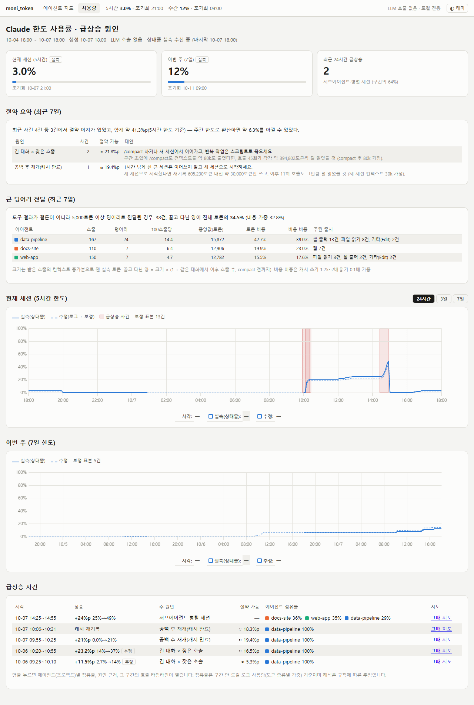
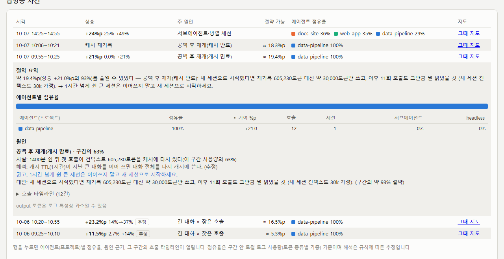
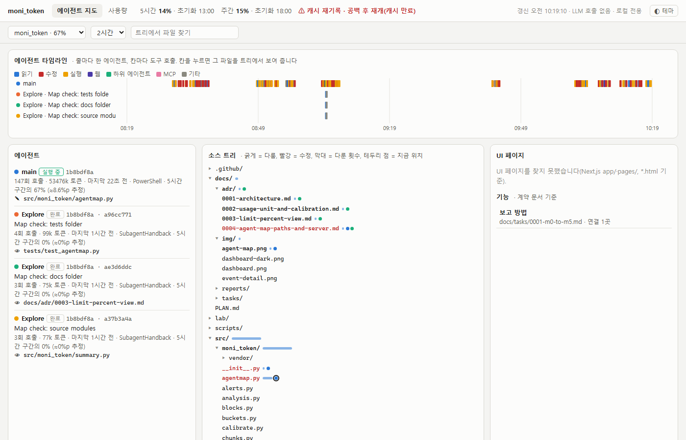

# moni_token

[English](README.md) · **한국어**

> "별로 한 것도 없는데 왜 50분 만에 Claude 한도가 5%나 빠졌지?"

moni_token은 Claude Code의 로컬 로그를 읽어서 이 질문에 답합니다. 한도 사용률이 갑자기 오르면 **어느 세션** 때문인지,
**어떤 패턴**이었는지(긴 대화에서 도구를 계속 호출, 오래 쉰 큰 세션을 이어 쓰기, 여러 세션을 동시에 돌리기 등),
다르게 했다면 **얼마나 아낄 수 있었는지** 알려 줍니다.

하는 일은 세 가지입니다.

1. **급상승 설명** — 한도 %의 시간 추이와 급상승 사건, 원인, 절약 가능량을 담은 정적 대시보드(2분마다 갱신,
   데스크톱 알림).
2. **진행 중 경고** — Claude Code 상태줄 앞에 `⚠ +4.0%p · 원인` 경고를 붙입니다.
   [claude-hud](https://github.com/jarrodwatts/claude-hud)를 쓰면 그 줄 앞에 붙습니다.
3. **에이전트 위치 표시** — 메인 세션과 서브에이전트가 프로젝트의 실제 소스 트리, UI 페이지, 계약 문서의 기능 중
   어디서 일하는지 보여 주는 실시간 지도.

원칙:

- **LLM을 부르지 않습니다.** 토큰을 아끼려는 도구가 토큰을 쓰면 안 되니까요. 판정은 모두 정해진 규칙으로 하고,
  설명 문장은 템플릿으로 만듭니다.
- **PC 밖으로 아무것도 보내지 않습니다.** 네트워크를 쓰지 않습니다. 대시보드는 HTML 파일이고, 에이전트 지도는
  127.0.0.1에서만 열립니다.
- **대화 내용을 저장하지 않습니다.** 숫자(토큰·시각·호출 수)와 메타데이터(세션 id, 프로젝트 폴더 이름, 모델,
  도구 이름, 크기, 도구가 다룬 프로젝트 기준 상대 경로 — [ADR-0004](docs/adr/0004-agent-map-paths-and-server.md))만 남깁니다.
- **로그는 읽기만 합니다.** Claude Code의 파일을 고치거나 지우지 않습니다.



<sub>합성 데모 데이터(`scripts/demo_report.py`)로 찍은 화면입니다.</sub>

## 화면에서 볼 수 있는 것

| 영역 | 알 수 있는 것 |
|---|---|
| 맨 위 카드 | 현재 5시간·주간 한도 사용률(%), 초기화 시각, 최근 24시간 급상승 건수 |
| 절약 요약 | 이번 주에 원인별로 몇 %p를 아낄 수 있었는지, 대안(예: "새 세션으로 시작")과 함께 |
| 큰 덩어리 전달 | 결론 대신 원문(파일 전체, 긴 명령 출력)을 그대로 넘긴 횟수와, 그걸 컨텍스트에 끌고 다닌 비용(프로젝트별) |
| 한도 그래프 | 시간에 따른 한도 %. 실선은 실측(Claude Code 상태줄 값), 점선은 로그로 추정한 값. 빨간 띠는 급상승 사건 |
| 급상승 사건 | 사건마다 원인. 행을 누르면 프로젝트별 점유율, 근거 수치, 그 구간의 호출 타임라인이 열림 |



### 알아내는 원인

| 원인 | 판정 근거 | 권고 예 |
|---|---|---|
| 긴 대화 × 잦은 호출 | 호출마다 큰 컨텍스트를 캐시에서 다시 읽고, 구간 안 호출 수가 많음 | `/compact` 하거나 새 세션에서 이어가기, 반복 작업은 스크립트로 묶기 |
| 공백 후 재개(캐시 만료) | 캐시 유효시간보다 오래 쉰 뒤 첫 호출이 대화 전체를 캐시에 다시 씀 | 오래 쉰 큰 세션은 이어 쓰지 말고 새 세션으로 시작 |
| 서브에이전트·병렬 세션 | 같은 구간에 여러 세션·사이드체인이 동시에 활동 | 동시에 돌리는 수를 줄이거나 순서대로 실행 |
| 캐시 미스 | 세션 도중 캐시 쓰기가 급증 | 작업 중 모델·설정 전환 줄이기 |
| 큰 입력 | 이미지·큰 파일을 읽은 직후 컨텍스트 급증 | 필요한 부분만 읽고, 원문은 파일로 넘기기 |
| 웹 조사 다수 | WebSearch·WebFetch 호출 집중 | 조사 범위를 좁히고 요약만 남기기 |
| 출력 폭주 | output 토큰 비중이 비정상적으로 큼 | 긴 결과물은 파일로 쓰게 하고 출력 길이 제한 |

원인과 근거 수치는 로그에서 확인한 사실이고, 해석에는 "추정"이라고 표시합니다.

## 기존 도구와의 차이

| 도구 | 잘하는 것 | moni_token이 더하는 것 |
|---|---|---|
| [ccusage](https://github.com/ryoppippi/ccusage) | 일·세션·5시간 구간별 토큰과 비용 집계 | 어떤 구간이 *왜* 비쌌는지 설명하고 사건으로 기록 |
| [Claude Code Usage Monitor](https://github.com/Maciek-roboblog/Claude-Code-Usage-Monitor) | 터미널 실시간 대시보드, 소모 속도, 한도 도달 예측 | 급상승을 세션과 패턴에 연결하고, 다르게 했을 때의 절약량 계산 |
| ccflare | 토큰·비용·속도 그래프를 보여 주는 로컬 웹 UI | 원인이 붙은 사건 목록과 호출 단위 타임라인 |
| [claude-hud](https://github.com/jarrodwatts/claude-hud) | 상태줄: 컨텍스트, 한도, 실행 중인 도구·에이전트, 할 일 | claude-hud 줄 앞에 원인이 붙은 급상승 경고(다시 만들지 않고 감싸서 씀) |
| [agents-observe](https://github.com/simple10/agents-observe) | 훅 이벤트를 로컬 웹 UI로: 서브에이전트 계층, 타임라인, 에이전트별 토큰 | 소스 트리·UI 페이지·계약 문서 기능 위의 위치 표시, 로그로 과거 세션도 읽음, Docker 불필요, 프롬프트·파일 내용 미저장 |

moni_token은 이 도구들을 대체하려는 게 아닙니다. 합계는 ccusage, 실시간 HUD는 claude-hud로 보고, 숫자가 이상하거나
에이전트가 어디서 일하는지 보고 싶을 때 moni_token을 쓰면 됩니다.

## 설치

필요한 것: Python 3.12 이상, [uv](https://docs.astral.sh/uv/). Windows 10/11에서 개발하고 쓰고 있습니다. 코드에
macOS(`osascript`)·Linux(`notify-send`) 알림 경로가 있지만 시험해 보지 않았고, 아래 설정 명령은 Windows 기준입니다.

```powershell
git clone https://github.com/reddol18/moni_token.git
cd moni_token
uv sync
uv run moni-token collect     # 처음 한 번은 기존 로그 전체를 ~/.moni_token/usage.db로 읽어 들임
uv run moni-token report      # ~/.moni_token/report.html 생성
start $HOME\.moni_token\report.html
```

한 번 보는 것은 여기까지면 됩니다. 아래는 자동으로 돌게 하는 설정입니다.

### 1. 2분마다 갱신 (권장)

`check`는 새 로그를 읽고, 새 급상승이 있으면 데스크톱 알림을 띄우고, 리포트를 다시 씁니다. 1초 정도 걸립니다.
Windows 작업 스케줄러에 등록하세요.

```powershell
uv run moni-token install-task                 # 2분마다, 배터리 사용 중에도 실행
uv run moni-token install-task --no-battery    # 배터리 사용 중에는 쉼
uv run moni-token install-task --map           # 에이전트 지도 서버도 로그인할 때(그리고 지금) 시작
uv run moni-token uninstall-task               # 둘 다 해제
```

로그인해 있는 동안만 돕니다. `install-task`를 다시 실행하면 기존 작업을 바꾸므로, 배터리 옵션은 언제든 전환할 수 있습니다.

### 2. 상태줄 기록기 (권장)

Claude Code는 상태줄 명령에 실제 한도 %를 넘겨 줍니다. moni_token은 그 숫자만 기록해서 그래프의 실선(실측)을 그리고,
추정값도 자동으로 보정합니다. `~/.claude/settings.json`에 다음을 추가하세요.

```json
"statusLine": {
  "type": "command",
  "command": "C:/path/to/moni_token/.venv/Scripts/moni-token-statusline.exe"
}
```

경로는 반드시 슬래시(`/`)로 쓰세요. Windows에서 Claude Code는 이 명령을 Git Bash로 실행하는데, Git Bash가 역슬래시를
지워 버려서 `C:\\path\\...`로 쓰면 아무 오류 없이 실행되지 않습니다.

상태줄에는 `5h 12% ~15:06 · ctx 40%` 같은 내용이 나옵니다. 이미 쓰는 상태줄 명령이 있으면 그대로 두고 감싸면 됩니다:
`moni-token-statusline.exe --wrap "<기존 명령>"`. 기록은 다음에 새로 여는 Claude Code 세션부터 쌓입니다.

급상승이 진행되는 동안에는 상태줄 맨 앞에 `⚠ +4.0%p · 공백 후 재개(캐시 만료)` 같은 짧은 경고가 붙습니다. 마지막
`check` 결과에서 가져오며, `realert_min`이 지나면 사라집니다.

**[claude-hud](https://github.com/jarrodwatts/claude-hud)와 함께 쓰기.** moni_token은 HUD 전체를 만들지 않습니다.
claude-hud를 쓴다면 상태줄 명령은 moni_token으로 두고 claude-hud 명령을 감싸세요. 그러면 한도 숫자가 계속 기록되고,
경고는 claude-hud 줄 앞에 붙습니다.

```json
"statusLine": {
  "type": "command",
  "command": "C:/path/to/moni_token/.venv/Scripts/moni-token-statusline.exe --wrap \"<claude-hud 명령>\""
}
```

claude-hud의 `/hud` 설정은 `statusLine`에 자기 명령을 써 넣습니다. 그 뒤에 그 명령을 `--wrap` 안으로 옮기면 됩니다.
Windows(Git Bash)에서는 `--wrap "C:\Users\<사용자>\.claude\plugins\claude-hud\statusline.cmd"`입니다. 따옴표 안에서는
역슬래시를 써도 됩니다.

### 3. 상태줄 없이: `/usage` 값을 직접 입력

Claude Code에서 `/usage`를 열고 보이는 숫자를 넣으세요.

```powershell
uv run moni-token observe --session 49 --session-reset "2026-10-07 02:30" --week 7 --week-reset "2026-10-13 18:00"
```

한 번만 넣어도 추정선이 그려지고, 여러 번 넣을수록 정확해집니다.

## 실시간 에이전트 지도

```powershell
uv run moni-token map          # http://127.0.0.1:4990/
```



<sub>이 기능을 만드는 동안 찍은 이 저장소 자신의 지도입니다. 세션 하나가 고친 파일이 빨강으로 보입니다.</sub>

메인 세션과 서브에이전트가 지금 프로젝트의 어디서 일하는지 세 가지로 보여 줍니다.

- **소스 트리**: 실제 디렉토리 트리입니다. 기간 안에 에이전트가 읽거나 고친 파일은 굵게(고친 파일은 빨강) 표시하고,
  실행 중인 에이전트의 지금 위치는 테두리 점으로 표시합니다.
- **UI 페이지**: 실제 파일에서 찾은 라우트(Next.js `app/`·`pages/`, 정적 `*.html`)입니다. 에이전트가 그 페이지의
  소스를 다루면 강조합니다.
- **기능**: 계약 문서(`docs/PLAN.md`, `PLAN.md`, `SPEC.md`, `docs/tasks/*.md`)의 절입니다. 그 절에 백틱으로 적힌
  경로나 겹치지 않는 파일 이름으로만 파일과 연결하고, `- [x]` 항목으로 진행도를 셉니다.

주소에 `?at=<epoch ms>`를 붙이면 과거 시점을 볼 수 있습니다(트리는 현재 파일 기준). 서버는 127.0.0.1에서만 열리고,
5초마다 새 로그를 읽습니다. 로그에서는 도구 이름과 프로젝트 기준 상대 경로만 남깁니다(ADR-0004). 서브에이전트의
작업 설명 문장은 보여 주지 않습니다.

## 명령

| 명령 | 하는 일 |
|---|---|
| `collect` | 새 로그 줄 읽기(증분: 파일마다 새로 생긴 부분만) |
| `check` | `collect` + 새 급상승 알림 + 리포트 갱신(작업 스케줄러용) |
| `install-task [--no-battery]` / `uninstall-task` | 2분 주기 `check` 작업 등록 / 해제(Windows) |
| `report [--days 7]` | HTML 대시보드 생성 |
| `map [--port 4990]` | 127.0.0.1에서 실시간 에이전트 지도 |
| `status` | 현재 5시간 구간, 속도, 구간 끝 예상치 |
| `events` | 기록된 급상승 사건과 절약 문장 |
| `savings` | 이번 주에 원인별로 아낄 수 있었던 양 |
| `analyze --from "2026-10-06 12:31" --to "2026-10-06 12:56"` | 원하는 구간을 골라 원인 분석(`--save`로 사건 기록) |
| `chunks` | API로 보낸 큰 덩어리, 프로젝트별 |
| `daily` / `blocks` | 날짜별 토큰 합계 / 5시간 구간 |
| `observe` / `calibrate` | 화면에서 본 한도 %를 입력해 보정 |
| `spikes`, `backfill-events`, `suggest-floor` | 탐지 세부 정보와 기준값 조정 |

모두 `uv run moni-token <명령>`으로 실행합니다.

### 설정

탐지 기준은 `~/.moni_token/config.toml`에 둡니다(모두 선택).

```toml
[spike]
pct_jump = 3.0          # window_min 안에 5시간 한도가 이만큼(%p) 오르면 급상승
window_min = 15
realert_min = 30        # 이 시간(분) 안에는 같은 알림을 다시 띄우지 않음
single_call_cache_write_tokens = 200000   # 호출 하나가 이만큼 캐시에 다시 쓰면 그 자체로 사건
```

## 내 데이터 없이 써 보기

```powershell
uv run python scripts/demo_report.py demo
start demo\report.html
```

위의 패턴을 모두 담은 가짜 로그를 만들고 그걸로 리포트를 생성합니다. 이 README의 스크린샷도 이걸로 찍었습니다.

## 한계

- **한도 %는 계정 전체 값인데, 로그는 이 PC 것만 있습니다.** claude.ai 웹 대화, 클라우드 세션, 다른 PC도 같은 한도를
  쓰지만 여기서는 보이지 않습니다. 그래서 추정값(점선)이 실제보다 낮을 수 있습니다. 상태줄로 받은 실측값은 정확합니다.
- **output 토큰이 적게 잡힐 수 있습니다.** Claude Code 로그에 중간값의 `output_tokens`가 남는 경우가 있습니다.
  moni_token은 한 응답의 여러 줄 중 최댓값을 쓰지만, 실제 값은 더 클 수 있습니다.
  https://github.com/anthropics/claude-code/issues/22671 참고.
- 사용량은 내장된 정가표(`src/moni_token/pricing.toml`)로 가중합니다. `verified = false`인 가격은 추정치입니다.
  이 표는 토큰 종류 간 상대 가중치만 정하고, %는 보정에서 나옵니다.
- 원인은 규칙 기반입니다. 어느 규칙에도 맞지 않는 구간은 "규칙에 맞는 원인 없음"으로 표시합니다.
- Claude Code 로그 형식은 공개 API가 아니어서 버전에 따라 바뀔 수 있습니다.

## 개발

```powershell
uv run pytest
```

설계 기록은 `docs/adr/`에 있습니다. 패키지가 LLM 클라이언트를 import하지 않는지 테스트로 검사합니다.

## 라이선스

MIT — [LICENSE](LICENSE) 참고.
