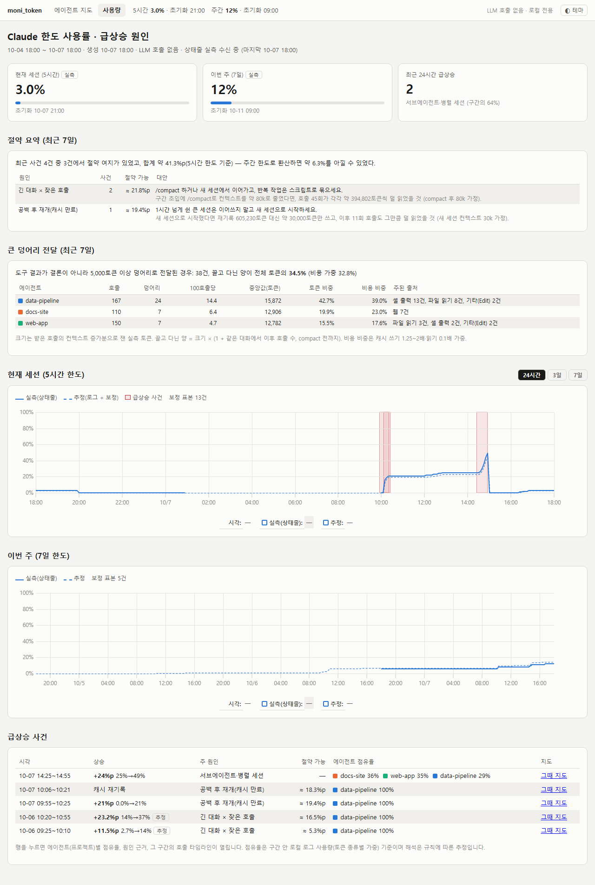
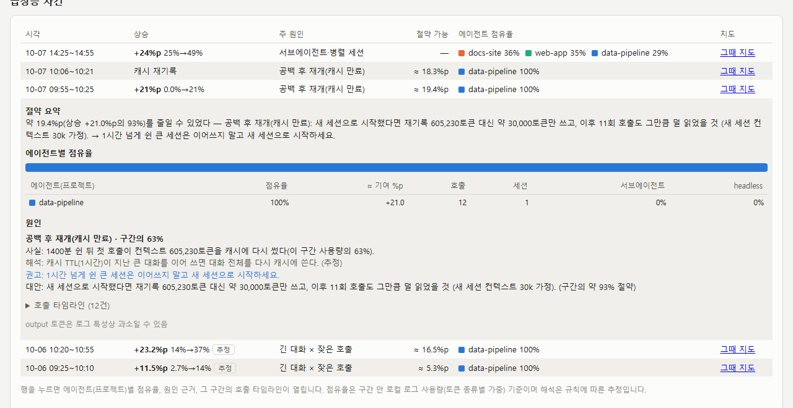
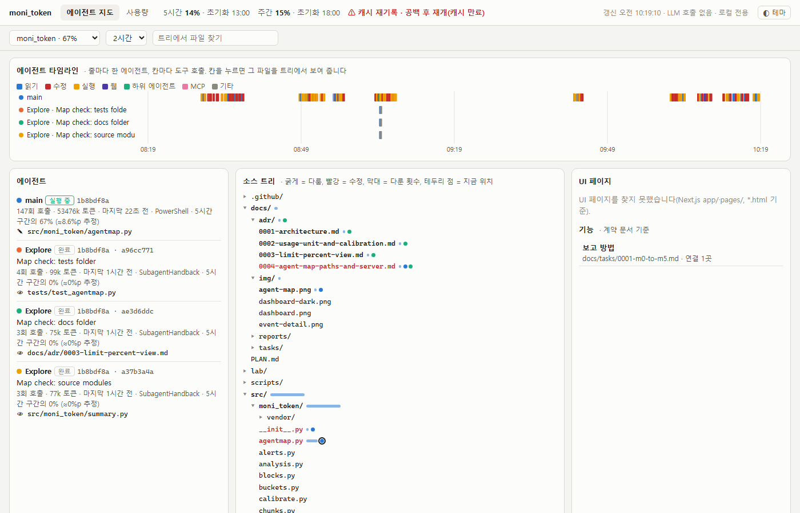

# moni_token

**English** · [한국어](README.ko.md)

> "I only did a little work, so why did 5% of my Claude limit disappear in 50 minutes?"

moni_token reads Claude Code's local logs and answers that question. When your limit usage jumps, it tells you
**which session** caused it, **which pattern** was behind it (a long conversation calling tools over and over, a big
session resumed after a long break, several sessions running in parallel, …) and **how much you could have saved**
by doing it differently.

It does three things:

1. **Explains spikes** — a static dashboard of limit % over time with every spike, its cause and the saving
   (refreshed every 2 minutes, with a desktop notification).
2. **Warns while it happens** — a short `⚠ +4.0%p · cause` segment on Claude Code's status line, also in front of
   [claude-hud](https://github.com/jarrodwatts/claude-hud) if you use it.
3. **Shows where agents are working** — a live map of the main session and its subagents on the project's real
   source tree, UI pages and the features of a contract document.

Principles:

- **No LLM calls.** A tool meant to save tokens should not spend them. Every judgement is a fixed rule, and every
  sentence comes from a template.
- **Nothing leaves your PC.** No network access. The dashboard is a static HTML file; the agent map is served on
  127.0.0.1 only.
- **No conversation text is stored.** Only numbers (tokens, times, call counts) and metadata (session id, project
  folder name, model, tool names, sizes, and the project-relative path a tool worked on — [ADR-0004](docs/adr/0004-agent-map-paths-and-server.md)).
- **Logs are read-only.** It never changes or deletes Claude Code's files.



<sub>Screenshot from synthetic demo data (`scripts/demo_report.py`). The dashboard UI is currently in Korean.
Dark theme: [docs/img/dashboard-dark.png](docs/img/dashboard-dark.png) — it follows the OS setting, or the ◐ button.</sub>

Charts are drawn with [uPlot](https://github.com/leeoniya/uPlot), bundled in the repo: drag to zoom, double-click to
reset, the cursor is shared between the 5-hour and weekly charts, and clicking a red spike band opens that spike.

## What it shows

| Section | What you learn |
|---|---|
| Tiles at the top | Current 5-hour and weekly limit usage in %, when they reset, and spikes in the last 24 hours |
| Savings summary | How many %p you could have saved this week, per cause, with the alternative (e.g. "start a new session") |
| Large chunks | How often raw tool output (whole files, long command output) was sent instead of a conclusion, and what carrying it in the context cost, per project |
| Limit charts | Limit % over time. Solid line = measured (from Claude Code's status line), dashed line = estimated from the logs. Red bands are spikes |
| Spike list | Each spike with its cause. Click a row for the per-project share, the evidence numbers and a timeline of the calls |



### Causes it recognises

| Cause | How it is detected | Typical advice |
|---|---|---|
| Long conversation × many calls | Each call re-reads a large cached context, and there are many calls in the window | `/compact`, or continue in a new session; bundle repetitive steps into a script |
| Resumed after idle (cache expired) | The first call after a gap longer than the cache TTL writes the whole context to the cache again | Don't resume a large session after a long break; start a new one |
| Parallel sessions / subagents | Several sessions or sidechains are active in the same window | Run fewer at once, or one after another |
| Cache miss | Cache writes surge in the middle of a session | Avoid switching model or settings mid-task |
| Large input | Context jumps right after reading an image or a big file | Read only the part you need; pass raw content as a file |
| Web research | Many WebSearch / WebFetch calls | Narrow the research and keep only summaries |
| Output burst | Output tokens take an unusual share | Have long results written to a file; limit output length |

The cause and its numbers are facts from the logs; the interpretation is labelled as an estimate.

## How it differs from existing tools

| Tool | What it does well | What moni_token adds |
|---|---|---|
| [ccusage](https://github.com/ryoppippi/ccusage) | Token and cost totals per day, session and 5-hour block | Explains *why* a period was expensive and records it as an incident |
| [Claude Code Usage Monitor](https://github.com/Maciek-roboblog/Claude-Code-Usage-Monitor) | Live terminal dashboard, burn rate, limit predictions | Attributes a spike to a session and a pattern, with a counterfactual saving |
| ccflare | Local web UI with token, cost and speed charts | Incident list with causes and per-call timelines |
| [claude-hud](https://github.com/jarrodwatts/claude-hud) | Status line: context, limits, active tools, running agents, todos | Spike warning with its cause in front of claude-hud's line (moni_token wraps it rather than re-implementing it) |
| [agents-observe](https://github.com/simple10/agents-observe) | Hook events into a local web UI: subagent tree, timeline, per-agent tokens | Positions on the source tree / UI pages / contract features; reads past sessions from the logs; no Docker, no prompt or file text stored |

moni_token does not try to replace these tools. Use ccusage for totals and claude-hud for the live HUD; use moni_token
when a number surprises you or you want to see where your agents are.

## Install

Requirements: Python 3.12+ and [uv](https://docs.astral.sh/uv/). Developed and used on Windows 10/11. The code has
macOS (`osascript`) and Linux (`notify-send`) notification paths, but they are untested; the setup commands below are
for Windows.

```powershell
git clone https://github.com/reddol18/moni_token.git
cd moni_token
uv sync
uv run moni-token collect     # first run reads all existing logs into ~/.moni_token/usage.db
uv run moni-token report      # writes ~/.moni_token/report.html
start $HOME\.moni_token\report.html
```

That's it for a one-off look. The steps below make it run on its own.

### 1. Refresh every 2 minutes (recommended)

`check` collects new log lines, shows a desktop notification for a new spike and rewrites the report. It takes
about a second. On Windows, register it with Task Scheduler:

```powershell
uv run moni-token install-task                 # every 2 minutes, also on battery
uv run moni-token install-task --no-battery    # pause while on battery
uv run moni-token install-task --map           # also start the agent map server at logon (and now)
uv run moni-token uninstall-task               # remove both
```

It runs only while you are logged on. Running `install-task` again replaces the task, so you can switch the battery
option at any time.

### 2. Status line recorder (recommended)

Claude Code passes the real limit % to the status line command. moni_token records just those numbers, which gives
the solid "measured" line and calibrates the estimate automatically. Add this to `~/.claude/settings.json`:

```json
"statusLine": {
  "type": "command",
  "command": "C:/path/to/moni_token/.venv/Scripts/moni-token-statusline.exe"
}
```

Use forward slashes. On Windows, Claude Code runs this command through Git Bash, which drops backslashes, so a
`C:\\path\\...` command silently never runs.

The status line then shows something like `5h 12% ~15:06 · ctx 40%`. If you already have a status line command,
keep it and wrap it: `moni-token-statusline.exe --wrap "<your old command>"`.
It starts recording from the next new Claude Code session.

While a spike is in progress, the status line starts with a short warning such as `⚠ +4.0%p · Resumed after idle`
(it comes from the last `check` run and disappears after `realert_min`).

**With [claude-hud](https://github.com/jarrodwatts/claude-hud).** moni_token doesn't try to be a full HUD. If you use
claude-hud, keep moni_token as the status line command and wrap claude-hud's command, so the limit numbers are still
recorded and the warning appears in front of claude-hud's line:

```json
"statusLine": {
  "type": "command",
  "command": "C:/path/to/moni_token/.venv/Scripts/moni-token-statusline.exe --wrap \"<claude-hud's command>\""
}
```

claude-hud's `/hud` setup writes its own command into `statusLine`; copy that command into `--wrap` afterwards.
On Windows with Git Bash that is `--wrap "C:\Users\<you>\.claude\plugins\claude-hud\statusline.cmd"` (keep the
quotes; backslashes are fine inside them).

### 3. Without the status line: enter `/usage` by hand

Type `/usage` in Claude Code and copy the numbers:

```powershell
uv run moni-token observe --session 49 --session-reset "2026-10-07 02:30" --week 7 --week-reset "2026-10-13 18:00"
```

One reading is enough to draw the estimate. More readings make it more accurate.

## Live agent map

```powershell
uv run moni-token map          # http://127.0.0.1:4990/
```



<sub>This repository's own map while this feature was being written: one session, files it edited in red.</sub>

Shows where each agent (main session and subagents) is working right now:

- **Agent timeline**: one row per agent over the selected period, one mark per tool call, coloured by kind
  (read / edit / run / web / subagent / MCP). Click a mark to jump to its file in the tree.
- **Source tree**: the real directory tree. Files an agent read or edited in the period are bold (red when edited),
  a bar shows how often each file or folder was touched, and a ringed dot marks where each running agent is now.
  Large folders are cut at 200 entries; touched files always show. A search box filters the tree.
  Next to each touched file: **what it cost in tokens**, e.g. `9k ×65 → 352k` — its tool result added 9k tokens to
  the context and was re-read by 65 later calls, so the conversation carried 352k tokens of it (≈ %p of the 5-hour
  limit when calibrated). Folders show the sum; each agent shows its heaviest file. Same measurement as
  `moni-token chunks`.
- **UI pages**: routes found from real files (Next.js `app/` and `pages/`, static `*.html`), highlighted when an agent
  touches their source.
- **Features**: sections of a contract document (`docs/PLAN.md`, `PLAN.md`, `SPEC.md`, `docs/tasks/*.md`), linked to
  files only through paths or unique file names written in backticks in that section; `- [x]` items give progress.

**Progress forecast** ([ADR-0005](docs/adr/0005-progress-forecast.md)): each unfinished subagent is compared with
finished runs of the same kind (`agentType`) that got at least as far, e.g. "call 4 · usually done by 21 (P50) – 46
(P85) · 3–9 min left · 193 past runs". Fewer than 10 comparable runs shows "not enough history". The agents panel
also shows how much of the 5-hour limit the running agents will probably still use (≈ +%p, P50–P85) and warns when
P85 would cross 100%. Contract documents get a completion estimate from the pace of past checklist ticks (snapshots
taken by `check`). `moni-token forecast` replays the past to check the ranges: on the author's PC, 92% of forecasts
fell within P85 and 59% within P50 — slightly wide, on the safe side.

The same server also serves the usage page at **http://127.0.0.1:4990/usage**, built from live data. Both pages share
a top line with the current 5-hour and weekly limit % and the live spike warning. Every spike on the usage page has a
**"그때 지도" (map at that time)** link that opens the map at the spike's end, on its top project; on the map, each agent and
project shows its share of the current 5-hour window (≈ %p via calibration, labelled as an estimate).

Add `?at=<epoch ms>` to the URL to look at a past moment (the tree is today's). The server listens on 127.0.0.1 only
and collects new log lines every 5 seconds. From the logs it keeps only tool names and project-relative target paths
(ADR-0004); subagent task descriptions are not shown.

## Commands

| Command | What it does |
|---|---|
| `collect` | Read new log lines (incremental; only the new part of each file) |
| `check` | `collect` + notification for new spikes + report refresh (for the scheduled task) |
| `install-task [--no-battery]` / `uninstall-task` | Register / remove the 2-minute `check` task (Windows) |
| `report [--days 7]` | Write the HTML dashboard |
| `map [--port 4990]` | Live agent map on 127.0.0.1 |
| `forecast` | Backtest the progress forecast on past subagent runs (P50/P85 coverage) |
| `status` | Current 5-hour window, speed and projection |
| `events` | Recorded spikes with their savings sentence |
| `savings` | What could have been saved this week, by cause |
| `analyze --from "2026-10-06 12:31" --to "2026-10-06 12:56"` | Explain any window you choose (`--save` records it) |
| `chunks` | Raw chunks sent to the API, per project |
| `daily` / `blocks` | Token totals per day / 5-hour windows |
| `observe` / `calibrate` | Enter limit % you saw, for calibration |
| `spikes`, `backfill-events`, `suggest-floor` | Detection details and tuning |

Run any of them as `uv run moni-token <command>`.

### Settings

Detection thresholds live in `~/.moni_token/config.toml` (all optional):

```toml
[spike]
pct_jump = 3.0          # 5-hour limit rising this many %p within window_min is a spike
window_min = 15
realert_min = 30        # no repeat notification within this many minutes
single_call_cache_write_tokens = 200000   # one call re-caching this much is a spike by itself
```

## Try it without your own data

```powershell
uv run python scripts/demo_report.py demo
start demo\report.html
```

This writes fake logs with all the patterns above and builds a report from them. The screenshots in this README come
from it.

## Limitations

- **Limit % is the account's value; the logs only cover this PC.** claude.ai web chats, cloud sessions and other PCs
  use the same limit but are invisible here, so estimates (the dashed line) can be lower than reality. Measured values
  from the status line are exact.
- **Output tokens may be undercounted.** Claude Code logs can record a partial `output_tokens` value. moni_token takes
  the maximum across the lines of one response, but the true value can still be higher. See
  https://github.com/anthropics/claude-code/issues/22671.
- Usage is weighted with a bundled list-price table (`src/moni_token/pricing.toml`). Prices marked
  `verified = false` are estimates. The table only sets the relative weight of token types; the % comes from
  calibration.
- Causes are rule-based. A window that fits no rule is shown as "no matching cause".
- The Claude Code log format is not a public API and may change between versions.

## Development

```powershell
uv run pytest
```

Design notes are in `docs/adr/`. A test checks that the package never imports an LLM client.

## License

MIT — see [LICENSE](LICENSE).

Bundled third-party code: uPlot 1.6.32, MIT, © Leon Sorokin — `src/moni_token/vendor/uplot/LICENSE`.
